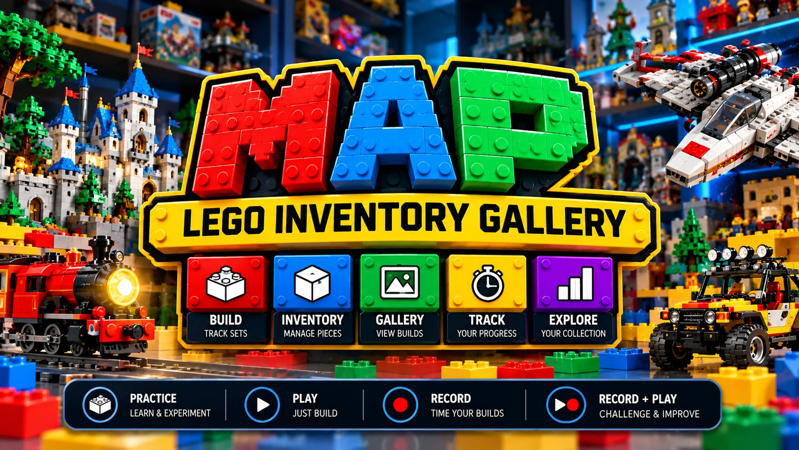
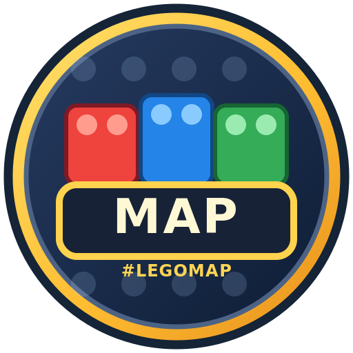

<div align="center">



# 🧱 LEGOMAP

### MAP's Brick Inventory Gallery

**Collect the sets. Count the pieces. Capture the builds. Challenge your personal best.**


*A personal LEGO® set organizer and build-time gallery, built for people who love making things.*

[Start building](#-get-started) · [Features](#-a-gallery-for-more-than-just-boxes) · [Time trails](#-build-time-trails) · [Backups](#-keep-your-collection-safe) · [Privacy](#-your-data-stays-yours)

</div>

---

> **🚧 Early public alpha.** This is a working browser-based prototype. The app can be used on a phone, tablet, or desktop, but browser file handling, offline storage, and auto-backup permissions vary by device. Keep a `.lemap` backup of any collection you care about.

## ✨ A gallery for more than just boxes

LEGOMAP brings **set inventory, ownership, build progress, finished-build photos, session timers, and recorded personal bests** into one colorful interface. It started as a personal project for a dedicated builder and now has a **portrait-free public edition** so anyone can create their own collection.

<table>
<tr><td width="50%"><strong>🧱 Build cards</strong><br>Track set name/number, genre, type, copies, piece counts, missing pieces, minifigures, progress, tags, notes, instructions links, and optional photos.</td><td width="50%"><strong>🖼️ Completion gallery</strong><br>Browse completed builds, photos, and collection details with search, genre filters, size filtering, and sorting.</td></tr>
<tr><td><strong>⏱️ Build-time trails</strong><br>Record genuine attempts, pause/splice a build across sessions, then rank finished recorded attempts by time and other measures.</td><td><strong>📊 Inventory at a glance</strong><br>See owned copies, total pieces, available/missing pieces, completed builds, minifigures, and configurable profile metrics.</td></tr>
<tr><td><strong>🎨 Personalize your workspace</strong><br>Choose from bright or dark brick-inspired themes. Customize profile metrics A/B; C tracks the latest build and D completed genres.</td><td><strong>🧮 Handy brick calculator</strong><br>Keep a floating calculator accessible while managing counts and collection details.</td></tr>
<tr><td><strong>💾 Portable .lemap files</strong><br>Export or restore a human-readable JSON container with compact dictionary-indexed set data and recorded time trails.</td><td><strong>🏆 Share the highlights</strong><br>Export CSV/PNG summaries, build cards, and time-trail results; create limited challenge snapshots and IB v2-style sharing links.</td></tr>
</table>

## 🚀 Get started

**No account, server, installation, or build tool is required.** The application is a standalone HTML file.

1. Open this repository's **Code → Download ZIP** (or download a release ZIP, once published).
2. Extract the ZIP on your computer or phone.
3. Open **`LEGOMAP_v0.1.0-alpha.1-r1_PUBLIC.html`** in a modern browser.
4. Use **`+ New set`** to add your first set and start building your collection.
5. Open **Settings → Export full `.lemap`** to make your first portable backup.

> **Phone tip:** Some mobile browsers restrict directly opening local `.html` files or their persistent storage. If the browser blocks local files, serve the exact same HTML through a trusted local static web server or host the **clean HTML only** on a static site. Opening the app from a different URL/browser may create a separate browser storage area; import your `.lemap` backup to move your collection.

### Already using a private LEGOMAP build?

**Keep your existing copy.** Export a full `.lemap` backup first. Open the public HTML separately, then import the backup only if you intentionally want to migrate your saved collection. Do not assume local storage transfers automatically between files, browsers, or devices.

## ⏱️ Build-time trails

There are four modes, depending on how much you want to track:

| Mode | What it's for | Ranked as a recorded finish? |
| --- | --- | --- |
| 🧪 **Practice** | Familiarize yourself with a set without pressure | No |
| ▶️ **Play** | Build casually | No |
| ⏺️ **Record** | Create a recorded build attempt | Yes, if finished |
| ⏺️▶️ **Record + Play** | Record while enjoying the build session | Yes, if finished |

**Splice sessions:** A build can span multiple days. Save a splice, return later, and continue your recorded attempt without treating it as a new finished time. The rankings use **finished, recorded** attempts—not ordinary practice/play sessions.

## 💾 Keep your collection safe

LEGOMAP saves automatically to browser storage when available (IndexedDB, with a localStorage fallback). **Browser storage is not a cloud backup** and can disappear when site data is cleared, a browser profile is reset, or certain mobile file contexts change.

- **Full backup:** `*.lemap` is a portable JSON backup that can contain names, photos, notes, storage locations, all set information, and time-trail history. **Treat it as private.**
- **Restore:** In Settings, choose **Restore `.lemap`** to import a saved collection.
- **Optional file auto-backup:** Available only where the browser supports and authorizes file writing; check whether it actually saved.
- **Exports:** CSV summaries and PNG cards are useful for sharing, but examine them first if you have entered identifying information.

**Do not upload a personal `.lemap` backup to a public repository or issue.** The same applies to private set photos, note archives, and exported profile pictures.

## 🔒 Your data stays yours

- **Local-first by design:** No account, remote database, or authentication service is required for inventory use.
- **No automatic collection synchronization:** Switching browsers/devices does not move your saved inventory.
- **Separate share mechanism:** Public challenge snapshots intentionally use a reduced selection of set metadata and aggregate results, rather than your full private backup.
- **Review before sharing:** Set names and other selected details in a public snapshot can still reveal information about a collection. Generated PNGs and profile exports may include pictures or user-defined names.
- **Hosted copy:** If you host the clean HTML on the web, hosting services can have their own access logs and privacy practices. The app's offline core does not require an external endpoint.

### What are IB v2 links?

The optional *itty-bitty-style* links carry compressed, limited challenge snapshots. They are **not** live sync and may exceed browser/URL limits for large collections. Some sharing features require browser compression support or a hosted HTTP(S) page.

## 🎨 Themes and controls

Bright bricks is the default; dark mode and several alternative palettes are available in Settings. The app also includes touch-oriented controls, a floating **+** button, a photo/gallery shortcut, and a detachable-style on-screen calculator.

| Gesture | Action |
| --- | --- |
| Tap **+** | Add a build card |
| Hold **+** for ~2.1 seconds | Open Settings |
| Tap the profile picture | Open the gallery |
| Hold the profile picture for ~1.8 seconds | Change the local profile picture |
| Tap **Save / Export `.lemap`** | Download your portable backup |

## 📁 Repository layout

```text
LEGOMAP/
├── README.md
├── LEGOMAP_v0.1.0-alpha.1-r1_PUBLIC.html    # The entire offline application
├── assets/
│   ├── LEGOMAP_public_banner.webp          # Public-facing promo art
│   ├── LEGOMAP_emblem.svg                  # Public, portrait-free emblem
│   └── LEGOMAP_emblem.png                  # PNG companion emblem
├── RELEASE_NOTES.md
└── .gitignore
```

No JavaScript build step, backend, framework install, or package manager is needed to use the HTML file.

## 🧩 Notes for contributors and curious builders

The app is currently **one self-contained HTML file** using browser HTML, CSS, and JavaScript. Keeping the public edition easy to copy and run is a key design goal. Reproduction reports should include browser/device, steps to reproduce, and whether the file was opened locally or hosted—but **never attach a private `.lemap`**.

Known early-alpha considerations: mobile file-opening behavior varies; browser storage is not always durable; long encoded sharing links can hit size limits; and browser permission for auto-backup is not universal.

## 📝 Licensing and trademarks

**License selection is pending.** Public source visibility does not automatically grant redistribution, modification, or commercial-use rights. Please add an explicit `LICENSE` file before inviting outside reuse.

**LEGO®** is a trademark of the LEGO Group. LEGOMAP is an independent fan-made inventory project and is **not affiliated with, sponsored, or endorsed by the LEGO Group**. Public graphics are custom project artwork, not official LEGO branding.

---

<div align="center">



### Build it. Log it. Remember it. 🧱🏆

**#LEGOMAP · A little more joy in every build.**

</div>
